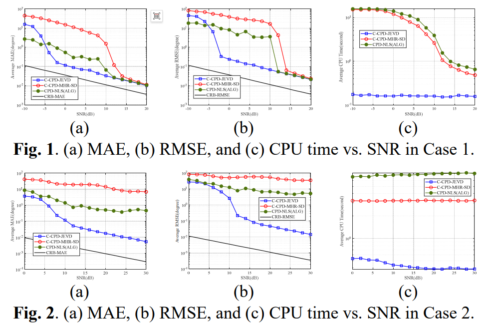

# [Multi-Base DOA] Coprime Multi-Base MIMO Radar Target Localization and Coupling Regular Polynomial Decomposition Based on Joint Eigenvalue Decomposition [Attached MATLAB Code]

This article investigates the problem of target positioning in multi-baseline, multi-input, and multi-output (MIMO) radar systems using coprime L-shaped arrays (CLsA). A new method for target positioning is proposed, which models the observation signal as a tensor and employs a coupled regularized polynomial decomposition (C-CPD) model without requiring matching filtering. This method includes a semi-algebraic algorithm based on a novel joint eigenvalue decomposition (J-EVD), as well as a post-processing step that determines the target position by integrating the arrival direction estimates extracted from the J-EVD results of the CCPD. Notably, leveraging the rotational invariance of the Van der Waerden structure within CLsA, the C-CPD problem is transformed into an equivalent J-EVD problem, significantly reducing computational complexity. Experimental results demonstrate that this method outperforms existing tensor-based methods.
Introduction In the past decade, multi-baseline (MS) multi-input, and multi-output (MIMO) radars have attracted increasing research attention due to their ability to provide rich spatial diversity and improve target positioning accuracy. Recently, coupling tensor modeling for MS MIMO radar has addressed the issue of array coupling and associated decomposition techniques, also drawing significant attention. From a signal processing perspective, the main steps from single-baseline / dual-baseline MIMO radars to MS radar involve evolving from single-group technology to multi-group data fusion, as multiple datasets need to be integrated from multiple receiving arrays. Some methods utilize structured tensor techniques to leverage array coupling and the multilinear (ML) structure of the dataset. For example, in [1], structured ML rank - (N_r  
, M_r  
, \(\cdot\)  
)
The block-item decomposition model addresses the subarray coupling issue in MS MIMO radars. In [5], the Coupling Normalized Polynomial Decomposition (C-CPD) was used without prior waveform knowledge. In [7], the dual C-CPD (DC-CPD) model was applied to subarray dual coupling. These studies mainly leverage the ML structure of MIMO radar signals, without focusing on specific array geometry.
In recent years, array geometry structures such as nested, interleaved, and minimum redundancy arrays have been widely used to reduce crosstalk compared to uniform linear arrays (see [9-16] for details). Literature [17-19] established the connection between sparse arrays and C-CPD, leading to a shift from traditional CPD-based methods [20] to coupled tensor processing, incorporating multidimensional harmonic retrieval (MHR) [21] with multiple stable ESPRIT [22] to consider harmonic structure. However, previous work based on single-base station has two main limitations: (1) the interleaved array method assumes uncorrelated sources with many pulses, which may fail under correlated RCS vectors or few pulses; (2) the unconstrained C-CPD method ignores the harmonic structure in the interleaved array.
In this study, we propose a target localization method for MS systems using interleaved L-shaped arrays (CLsA), which is realized through a C-CPD based on Joint Eigenvalue Decomposition (J-EVD). Firstly, we develop a C-CPD model for a MIMO radar system with one transmitter and multiple receivers. Then, by leveraging the rotational invariance of the Van dermonde structure in CLsA, the C-CPD problem is transformed into an J-EVD problem, thereby reducing computational complexity. The working conditions of the proposed algorithm are also studied to provide insights into its model recognitionability. Finally, post-processing techniques are employed to calculate and fuse DOA information for target localization.
Figure caption
Conclusion This paper proposes a target positioning method for an MS system using CLsA, which is realized through the C-CPD based on J-EVD. An algebraic C-CPD algorithm based on J-EVD is introduced, utilizing the van dermonde structure in CLsA, and a post-processing method to calculate the target position by integrating DOA parameters extracted from the results of the C-CPD based on J-EVD. The working conditions of the proposed algorithm are studied to provide insights into its model recognition capabilities. Experimental results show that this method outperforms existing tensor-based methods.

## Images

<!-- PAYMENT_BLOCK -->

## Get this dataset

- Payment link (Stripe): [Buy now](https://buy.stripe.com/3cs8yP7sY87d0vu9AB)
- Payment QR code: 

<!-- /PAYMENT_BLOCK -->
